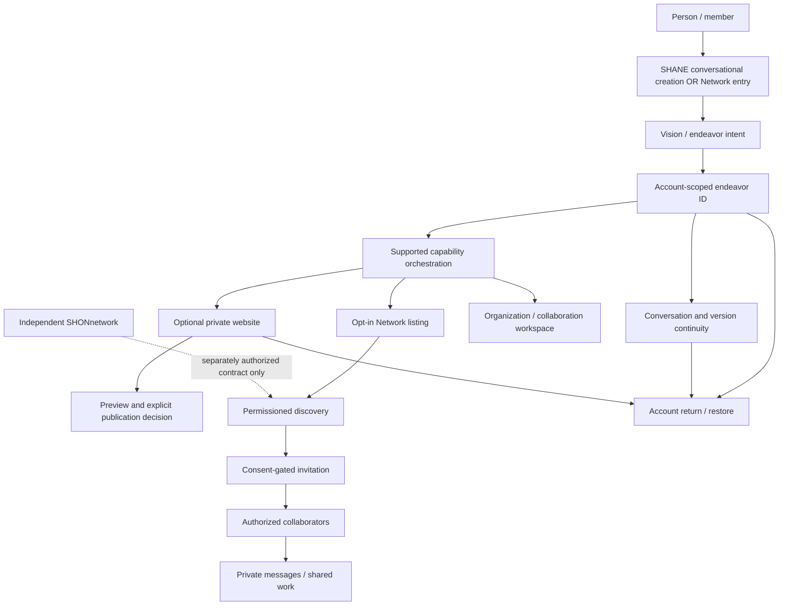

# SHANE integrated systems map and audit dependency graph

Status: **working source-level map**, not proof of live behavior. Scope: SHANE development branch `audit/vision-alignment-baseline-20261103`. Source of truth: `SHANE-PRODUCT-CONTRACT.md`; evidence and findings: `docs/SHANE-SHON-VISION-INTEGRATION-AUDIT.md`.

## Guiding architecture

**One central endeavor identity** connects creation, network discovery, people, memberships, conversations, optional websites, and specialized hubs. Websites and AI are capabilities, **not prerequisites**. SHONnetwork remains separately governed; no implicit sharing, migration, or modification.

## Source-backed integration edges

| Source | Trigger / relationship | Destination | Identity / consent invariant | Verification |
| --- | --- | --- | --- | --- |
| `builder.html` | `shaneChatSave` → `saveEndeavorAccount` | `shane_endeavors` | Signed-in owner; preserve existing endeavor ID | Source traced; real account pending |
| `builder.html` | Successful endeavor save emits `shane:endeavor-account-saved` | `shane-unified-private-save.js` | Never claim website saved before website insert | Source traced; mock DOM tests |
| `shane-unified-private-save.js` | New substantial website draft and no existing selected site → `saveSite.click()` | `builder.html` website save | No automatic overwrite or publication | Bridge unit checks; browser pending |
| `builder.html` | `saveSite` inserts `status:'draft'` | `shane_sites` | Owner-scoped private website; no concurrent duplicate insert | In-flight guard committed; test pending |
| `builder.html` | Successful website insert → `linked_site_id` update | `shane_endeavors` | Link only original active endeavor and same editor state | Source traced; failure/race tests pending |
| `builder.html` | Return URL `builder.html?endeavor=<id>` and saved endeavor open | Owner-scoped endeavor, conversation and linked site | Restore without overwriting unrelated unsaved edits | Source traced; browser pending |
| `shane-creative-continuity.js` | Active endeavor carried to Network discovery | Network listing / member flow | Never treat URL/client ID as authorization | Source traced; RLS runtime pending |
| `members.html` | Listing draft includes `endeavor_id` | `shane_listings` | Owner must own linked endeavor; draft by default | Source traced; two-account test pending |
| `shane-endeavor-collaboration.js` | Linked endeavor and accepted collaboration request | Workspace / private communication | Only authorized participants access | Source traced; live acceptance pending |
| Product contract | Specialized network integration | SHON and future hubs | Separate authorization; revocable; no silent private data exposure | Contract defined, implementation not certified |

## Cross-system fault map

| Failure boundary | Observed finding | Mitigation / outstanding work |
| --- | --- | --- |
| Saved website list → new website | First existing website could be implicitly selected | Explicitly clear unrelated selection; browser test outstanding |
| Website save → active endeavor | User switches endeavors during async insert | Snapshot endeavor ID before await; do not link switched endeavor |
| Repeated save event → website insert | Duplicate requests can overlap | In-flight save guard committed; execute concurrency test and browser tests |
| Website insert → endeavor link | Partial success can leave private website without association | Surface partial outcome; safe idempotent link-repair needed |
| Website revision → persistence | Existing website is not automatically overwritten | Add explicit safe revision/update path and version validation |
| Return → restored full session | Endeavor ID, conversation, website, versions need joint restoration | Cross-session browser/account test |
| Discovery → invitation → messages | Different permissions and identities across pages | Two-account positive/negative RLS and messaging tests |
| AI interpretation → operation | Real executable creation not yet established end-to-end | Demonstrate substantial persisted result, not navigation or forms |
| Artwork → actual interface | Original artwork installation not verified | Asset provenance, actual UI integration and responsive screenshots |
| SHANE → SHON | Unauthorized coupling could expose sensitive records | Keep physically separate; consented contract tests before any integration |

## Audit execution order: verify connected journeys, not isolated screens

1. **Identity and ownership**: two real accounts, private record access denial, independent endeavor creation.
2. **Creation and persistence**: describe intent, produce real output, save endeavor, optionally save/link website, inspect DB association.
3. **Recovery and concurrency**: reload, sign out/in, restore, revision/rollback, duplicate-click, slow response, failed link, endeavor switch.
4. **Network collaboration**: discover only permitted listings, consented invitation, acceptance/rejection, message exchange and revocation.
5. **Experience and operations**: artwork, accessibility, mobile/desktop, diagnostics, performance, deployment parity and rollback.
6. **Specialized hubs**: verify SHON independence and any future explicitly authorized integration contract.

Each edge must have: **source → event/API → destination → identity → permission → persisted result → failure/retry behavior → test evidence**. Keep unresolved edges open; do not infer completion from source wiring. All fixes must preserve existing functionality and stay on the development branch until verified.
